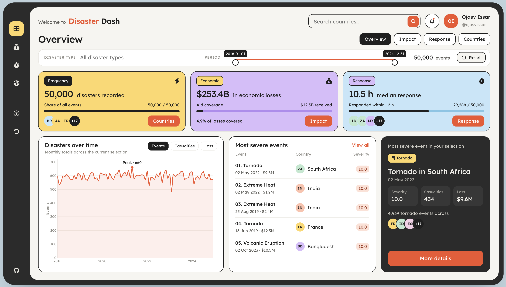
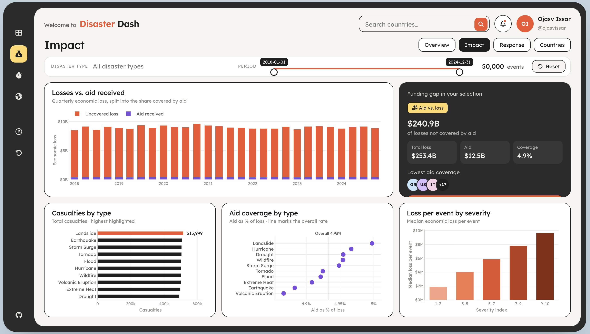
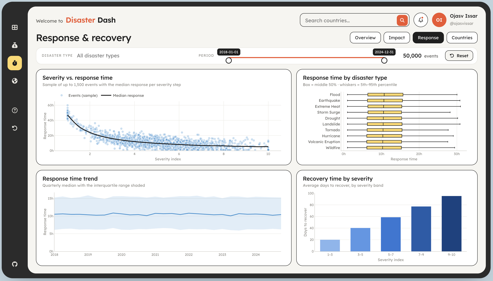
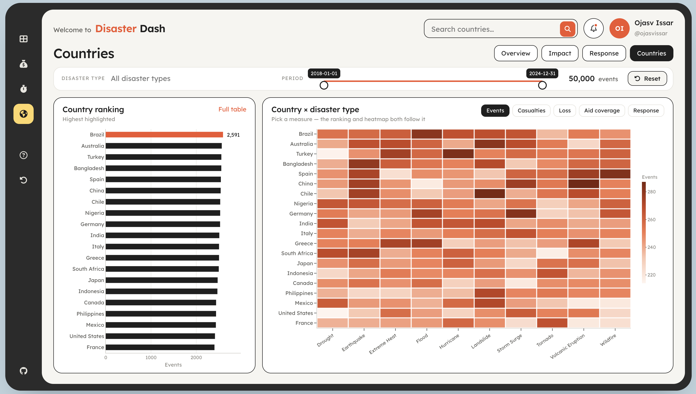

# 🌍 Disaster Dash (R)

**Global Disaster Impact & Humanitarian Aid · 2018–2024**

An interactive R Shiny dashboard exploring disaster frequency, economic losses, casualties and response times across 20 countries.

**[Live App](https://019ce3ab-c7c7-4487-8434-582db5539b78.share.connect.posit.cloud/)** · Based on the group project [DSCI-532_2026_18_disasterdash](https://github.com/UBC-MDS/DSCI-532_2026_18_disasterdash)



## Views

| View | What it shows |
|---|---|
| **Overview** | KPI cards, monthly trend, most severe events, spotlight on the worst event |
| **Impact** | Losses vs. aid, funding gap, casualties and aid coverage by type, loss by severity |
| **Response** | Severity vs. response time, response time by type, response trend, recovery by severity |
| **Countries** | Country ranking and country × disaster type heatmap, plus a full table |

Filter by country, disaster type and period. Every chart reads from one reactive, `filtered_df()`. On desktop, each view fits on one screen.

<details>
<summary><b>More screenshots</b></summary>





</details>

## Run locally

```bash
git clone https://github.com/ojasvissar/r-disaster-dash.git
cd r-disaster-dash
Rscript -e 'install.packages(c("shiny", "bslib", "dplyr", "plotly", "lubridate"))'
Rscript -e 'shiny::runApp("app.R", launch.browser = TRUE)'
```

Requires R ≥ 4.3. Data lives in `data/global_disaster_response_2018_2024.csv`. If the file is missing, the app generates synthetic demo data.

## Author

**Ojasv Issar** · [@ojasvissar](https://github.com/ojasvissar) · UBC MDS 2026
